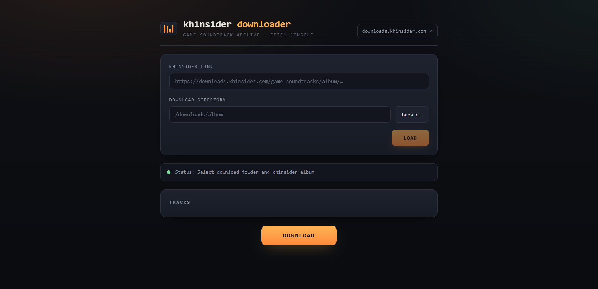

# khinsider Downloader Web App

A web app version of [khinsider-downloader-gui](https://github.com/Andrew-K961/khinsider-downloader-gui), built to run on a NAS home server via Docker.

Paste a khinsider.com URL, browse the tracks, and download them straight to your server — all from a browser.



## Features

- **Browser-based** — no desktop client needed, works from any device on your network
- **URL indexing** — paste a khinsider.com album/artist URL to list available tracks
- **Direct downloads** — save files to a directory on the host
- **Lightweight** — small Alpine-based image with a built-in healthcheck
- **Docker-ready** — runs as a non-root user out of the box

## Quick Start

### Using Docker Compose (recommended)

Create a `docker-compose.yml` file:

```yaml
services:
  khdownloaderweb:
    image: ghcr.io/andrew-k961/khdownloaderweb:latest
    container_name: khdownloaderweb
    ports:
      - "3000:3000"
    volumes:
      - /path/to/downloads:/downloads
    restart: unless-stopped
```

Then start it:

```bash
docker compose up -d
```

Open your browser and go to `http://<your-server-ip>:3000`.

### Using Docker directly

```bash
docker run -d \
  --name khdownloaderweb \
  -p 3000:3000 \
  -v /path/to/downloads:/downloads \
  --restart unless-stopped \
  ghcr.io/andrew-k961/khdweb:latest
```

## Configuration

| Option | Description | Default |
| --- | --- | --- |
| `3000` (port) | The port the web UI is served on | `3000` |

The container runs as a non-root user (`PUID`/`PGID`, default `1000`). You can change it using the `user:` compose tag or `--user:` run flag.

## Project Structure

```
├── server.mjs          # Express + Socket.IO server
├── indexer.py          # Parses khinsider.com URLs into a track list
├── downloader.py       # Downloads selected tracks
├── public/             # Frontend (HTML, CSS, JS)
├── Dockerfile
└── docker-compose.yml
```

## License

MIT
